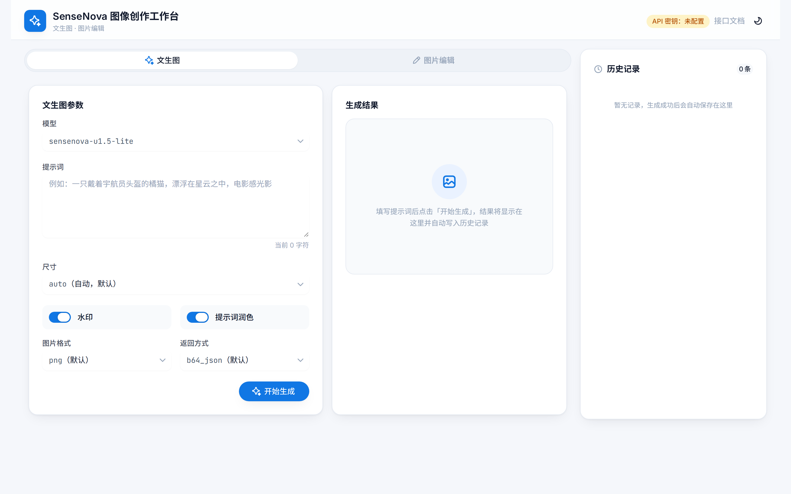
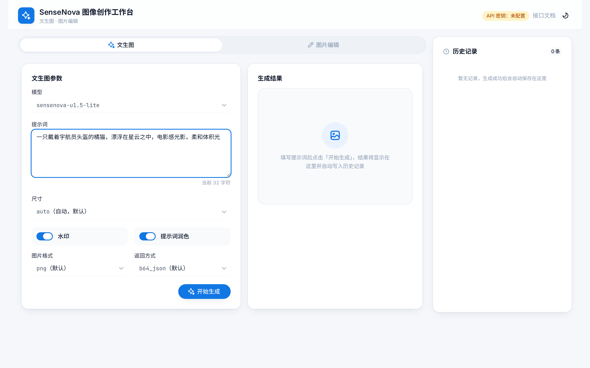
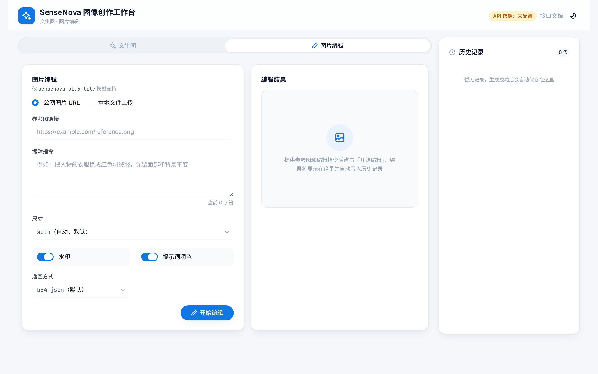
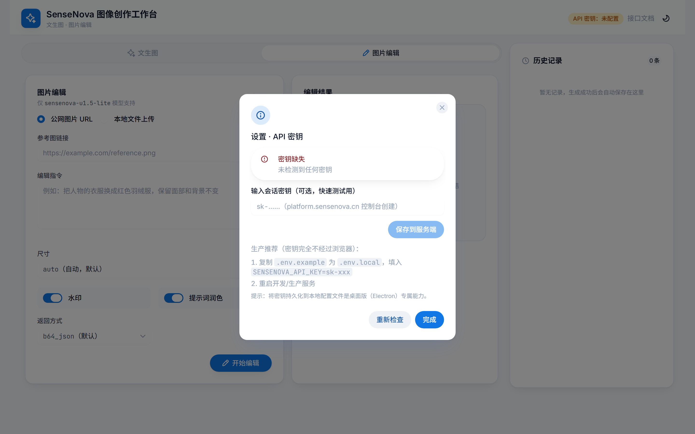

# SenseNova 图像创作工作台

SenseNova 图像模型的网页客户端，非官方。填提示词出图、传图改图，结果留在本地。

技术栈：Next.js（App Router）+ React 19 + TypeScript + Tailwind CSS v4 + HeroUI v3。



## 能做什么

- 两个模型，走 SenseNova 的图像接口（`/v1/images/generations`、`/v1/images/edits`），不是 Chat Completions：
  - `sensenova-u1-fast`：只能文生图，尺寸是固定的 11 个常量里选，返回的图片链接 1 小时过期。
  - `sensenova-u1.5-lite`：文生图 + 图片编辑，尺寸（预设或自定义）、图片格式、返回方式、提示词润色都能调。
- 图片编辑的参考图：填公网 URL，或本地选一张图（读成 `data:image/*;base64` 再发）。
- 上传前压缩：本地大图按长边等比缩放、重编码，减小体积；带透明通道的 PNG 不会被压成 JPEG。
- 结果图不依赖临时链接：代理拿到上游返回后，在本地服务端把图片下载转成 Data-URL 再回前端，u1-fast 那条 1 小时链接过期也不影响。
- 历史记录存浏览器 IndexedDB，带缩略图，关掉重开还在。
- 密钥只在本地服务端，不进浏览器。
- 深浅色主题，中文界面，桌面双栏、窄屏单栏。



## 快速开始

前置：Node 18 以上；一个 SenseNova 平台账号。

1. 复制 `.env.example` 为 `.env.local`，填：

   ```bash
   SENSENOVA_API_KEY=sk-xxxxxxxx
   ```

   密钥在 platform.sensenova.cn 控制台创建。

2. 装依赖、起服务：

   ```bash
   npm install
   npm run dev
   ```

3. 打开 http://localhost:3000 。没配密钥时，界面和接口会给出明确的「未配置」提示，不会崩。

校验：

```bash
npm run build   # 生产构建 + 类型检查
npm run test    # 三个请求体的契约断言
```



## 常见问题

**图片链接过期打不开怎么办？**
应用不靠那条临时链接。代理在服务端把图下载下来转成 Data-URL 再返回，历史里存的就是 Data-URL，24 小时后照样能看。

**水印和 prompt_extend 是干什么的？**
`watermark` 是官方 Logo 水印，默认开，关掉在公测期免费。`prompt_extend` 让模型先把你的提示词扩写润色再生图，关掉就完全按你写的来。`sensenova-u1-fast` 没有 `output_format` / `response_format` / `prompt_extend` 这几个参数，只有 `watermark` 是两边都显式发的。

**历史记录存在哪里？**
浏览器 IndexedDB（不是 localStorage，容量放得下原图）。每条存原图和一张 256px 缩略图，列表只读缩略图，点开才载原图。换浏览器或清站点数据会没。

**密钥会不会进浏览器？**
不会。请求由本地 Next 服务转发到 `token.sensenova.cn`，密钥待在服务端。开发期用 `.env.local`；也可以在右上角「API 密钥」里临时存到服务端内存（重启失效，只适合本机）。



## 接口契约（改代码前先看）

- `n` 只支持 1。
- `sensenova-u1-fast` 的 size 只能从 11 个常量里选，不接受自定义宽高。
- `sensenova-u1.5-lite` 自定义 size：宽高是 32 的倍数、范围 512~4096、比例最大 3:1。
- 编辑接口的 `image_url` 只接受完整 http/https 链接，或带 `data:image/*;base64,` 前缀的 Data-URL。

## License

GPL-3.0，全文见 [LICENSE](LICENSE)。

Copyright (c) 2026 HasselNot7

这不是商汤官方的产品。SenseNova 的接口、名称与商标归 SenseNova 官方所有，API 用量和计费以官方平台为准。
